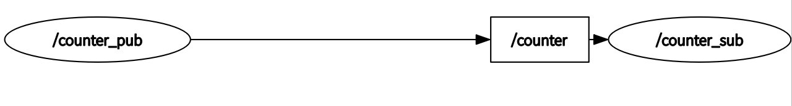
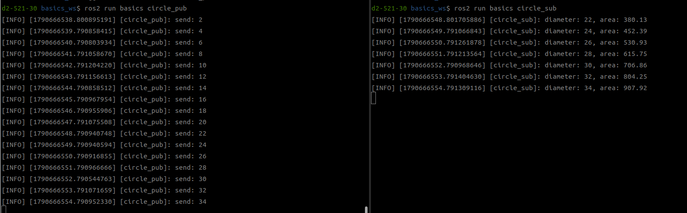
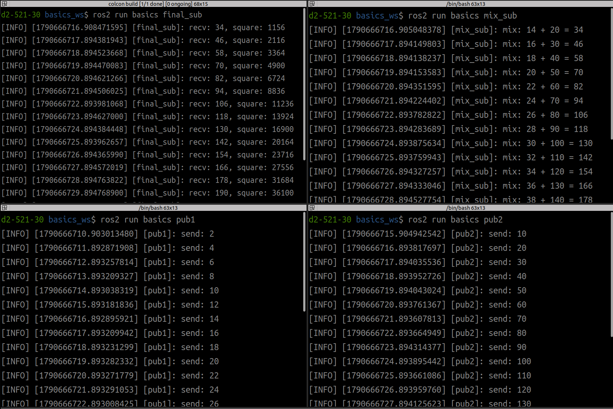
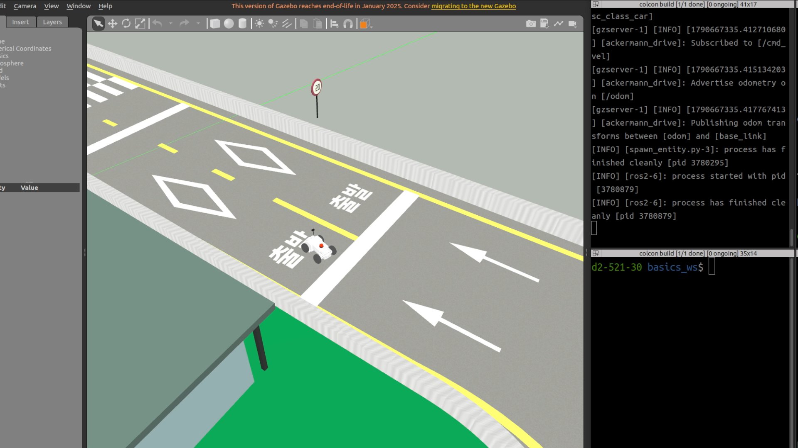

# 3주차 — ROS 2 기초 1: 노드와 토픽

> 오늘은 **새 워크스페이스를 바닥부터** 만들고, 첫 패키지·첫 통신을 완성한 뒤, 같은 패키지로 차량을 움직입니다.
> 명령어와 코드는 이 문서에서 **복사–붙여넣기** 하세요. `$` 는 Ubuntu 터미널입니다.

## 오늘 실습의 전체 로드맵

0. 지난주 환경 점검 — 시뮬레이터가 뜨는가 (안 되면 복구 절차)
1. 새 워크스페이스 `basics_ws` 만들기 (ssc_ws는 그대로 둔다)
2. 내 패키지 `basics` 생성 — `ros2 pkg create`
3. Publisher 작성 — `counter_pub` (2 Hz 카운터 발행)
4. 빌드·등록·실행 — setup.py, colcon build, ros2 run
5. Subscriber 작성 — `counter_sub` (구독·출력)
6. 그래프 관찰 — rqt_graph, 그리고 차량 토픽과의 만남
7. 내 패키지로 차량 제어 — `straight_stop`

---

## [단계 0-a] 지난주 환경 점검 — 시뮬레이터 실행

터미널을 열고, 순서대로.

① 강의 저장소를 이번 주 버전으로:

```bash
cd ~/ssc_ws/src/ssc_class
git pull
git remote update
git checkout week-03
```

② 시뮬레이터 실행:

```bash
source ~/ssc_ws/install/setup.bash
ros2 launch ssc_class_gazebo license_course.launch.py
```

**시험장 월드와 차량이 보이면** → 이 터미널은 그대로 두고 [단계 1]로.
오류가 나면 → 아래 증상별 복구 절차.

## [단계 0-b] 안 될 때 — 증상별 복구 절차

**증상 1: `ros2: command not found`**

```bash
source /opt/ros/humble/setup.bash
```

매번 그러면 2주차 자료의 .bashrc 등록부터 다시.

**증상 2: `package 'ssc_class_gazebo' not found`**

```bash
cd ~/ssc_ws && colcon build --symlink-install
source ~/ssc_ws/install/setup.bash
```

**증상 3: `~/ssc_ws` 자체가 없거나 심하게 꼬임 — 전체 재구축 (약 3분)**

```bash
mkdir -p ~/ssc_ws/src && cd ~/ssc_ws/src
git clone https://github.com/DCUSnSLab/automotive-sw-2026.git ssc_class
cd ssc_class && git checkout week-03 && cd ~/ssc_ws && colcon build --symlink-install
```

**증상 4: Gazebo 화면이 검거나 즉시 종료**

```bash
ros2 launch ssc_class_gazebo license_course.launch.py software_gl:=true
```

> ※ 10분 안에 해결되지 않으면 손을 드세요 — 오늘 실습의 대부분은 시뮬레이터 없이도 진행 가능하니 멈춰 있지 말 것.

## [단계 1] 새 워크스페이스 — basics_ws

새로운 워크스페이스 생성 (**새 터미널**에서):

```bash
mkdir -p ~/basics_ws/src
cd ~/basics_ws/src
```

- 지난주의 `~/ssc_ws`는 그대로 둔다 — 시뮬레이터는 ssc_ws에 유지
- 실습용 basics_ws와 ssc_ws는 분리됨
- 워크스페이스가 여러 개여도 통신에는 아무 문제 없음 (단계 6에서 확인)

## [단계 2] 내 패키지 생성 — ros2 pkg create

`~/basics_ws/src` 에서:

```bash
ros2 pkg create --build-type ament_python basics --dependencies rclpy std_msgs geometry_msgs
```

생성된 구조 확인:

```bash
ls basics
```

- `package.xml` — 매니페스트
- `setup.py` — 실행 명령 등록부
- `basics/` — 파이썬 코드가 들어갈 폴더

> ※ 2주차의 ssc_class는 남이 만든 패키지를 사용한 것 — 지금은 새로운 패키지를 생성했다.

## [단계 3] 첫 Publisher — counter_pub.py

0.5초마다 숫자를 하나씩 발행하는 노드. VS Code로 작성:

```bash
code ~/basics_ws/src/basics
```

`basics/basics/counter_pub.py` 생성:

```python
import rclpy
from rclpy.node import Node
from std_msgs.msg import Int32


class CounterPub(Node):
    def __init__(self):
        super().__init__('counter_pub')
        self.pub = self.create_publisher(Int32, '/counter', 10)
        self.timer = self.create_timer(0.5, self.tick)    # 2 Hz
        self.count = 0

    def tick(self):
        msg = Int32()
        msg.data = self.count
        self.pub.publish(msg)
        self.count += 1


def main(args=None):
    rclpy.init(args=args)
    node = CounterPub()
    rclpy.spin(node)
    node.destroy_node()
    rclpy.shutdown()


if __name__ == '__main__':
    main()
```

**코드 설명 — 오늘 이론과의 연결**

- `from std_msgs.msg import Int32` — 표준 메시지
- `super().__init__('counter_pub')` — 그래프에 이 이름으로 등장
- `create_publisher(Int32, '/counter', 10)` — 타입 · 토픽 이름 · 큐 크기 10
- `create_timer(0.5, self.tick)` — 0.5초마다 콜백
- `publish(msg)` — 구독자가 있든 없든 발행 (pub/sub의 익명성)
- `main()`의 init → spin → shutdown은 노드 생애 주기 그대로

## [단계 4] 등록·빌드·실행

① `setup.py`의 entry_points에 실행 이름 등록:

```python
    entry_points={
        'console_scripts': [
            'counter_pub = basics.counter_pub:main',
        ],
    },
```

② 빌드 + 환경 등록:

```bash
cd ~/basics_ws && colcon build --symlink-install
source install/setup.bash
```

③ 실행:

```bash
ros2 run basics counter_pub
```

> ※ 새 터미널을 열면 `source ~/basics_ws/install/setup.bash` 를 다시 해야 합니다.
> ※ 이후 노드를 추가할 때마다: entry_points 한 줄 + colcon build.

## [단계 5] 첫 Subscriber — counter_sub.py

`basics/basics/counter_sub.py` 작성 후 setup.py에 `counter_sub` 등록, 재빌드 (단계 4 참고):

```python
import rclpy
from rclpy.node import Node
from std_msgs.msg import Int32


class CounterSub(Node):
    def __init__(self):
        super().__init__('counter_sub')
        self.sub = self.create_subscription(Int32, '/counter', self.on_msg, 10)

    def on_msg(self, msg):
        self.get_logger().info('recv: %d' % msg.data)


def main(args=None):
    rclpy.init(args=args)
    node = CounterSub()
    rclpy.spin(node)
    node.destroy_node()
    rclpy.shutdown()


if __name__ == '__main__':
    main()
```

새 터미널에서:

```bash
source ~/basics_ws/install/setup.bash
ros2 run basics counter_sub
```

counter_pub 터미널과 나란히 놓고 숫자가 흘러가는 것 확인. 명령어로도 같은 것을 볼 수 있다:

```bash
ros2 topic echo /counter
```

## [단계 6-a] 그래프 관찰 — 내가 만든 통신

새 터미널에서:

```bash
rqt_graph              # counter_pub → /counter → counter_sub 확인
ros2 topic hz /counter    # 약 2 Hz — create_timer(0.5, …)의 결과
ros2 topic info /counter  # 타입 확인
```



## [단계 6-b] DDS, 워크스페이스 확인

시뮬레이터는 ssc_ws에서, 내 노드는 basics_ws에서. (시뮬레이터가 꺼져 있다면:)

```bash
cd ~/ssc_ws && source install/setup.bash
ros2 launch ssc_class_gazebo license_course.launch.py
```

```bash
ros2 topic list
```

- 차량·실습 토픽 동시 확인: `/counter`, `/scan`, `/odom`, `/cmd_vel`
- **워크스페이스는 빌드·설치 단위, 통신은 DDS가 진행** — 등록 절차도, Master도 없이 통신 확인
- 차량 데이터도 그대로 읽힌다:

```bash
ros2 topic echo /odom --once
```

## [단계 7] 내 패키지로 차량 제어 — straight_stop.py

counter_pub와 구조는 같음, 타입만 Int32 → Twist. `basics/basics/straight_stop.py` 작성, setup.py 등록, 재빌드:

```python
import rclpy
from rclpy.node import Node
from geometry_msgs.msg import Twist


class StraightStop(Node):
    def __init__(self):
        super().__init__('straight_stop')
        self.pub = self.create_publisher(Twist, '/cmd_vel', 10)
        self.timer = self.create_timer(0.1, self.tick)   # 10 Hz
        self.t = 0.0

    def tick(self):
        msg = Twist()
        if self.t < 3.0:
            msg.linear.x = 1.0
        self.pub.publish(msg)
        self.t += 0.1


def main(args=None):
    rclpy.init(args=args)
    node = StraightStop()
    rclpy.spin(node)
    node.destroy_node()
    rclpy.shutdown()


if __name__ == '__main__':
    main()
```

시뮬레이터가 떠 있는 상태에서 (단계 0):

```bash
ros2 run basics straight_stop
```

검증 — 눈이 아니라 데이터로:

```bash
ros2 topic echo /odom --once     # 실행 전후 position 비교: 약 3 m 이동했는가?
```

rqt_graph를 다시 열어 보자 — 내 straight_stop이 지난주 teleop의 자리(/cmd_vel 발행자)에 서 있다.
생각해 보기: Ctrl+C로 끊으면 차는 왜 멈출까?

## 자주 하는 실수

| 증상 | 해결 |
|---|---|
| `ros2 run`에서 basics를 못 찾음 | 그 터미널에서 `source ~/basics_ws/install/setup.bash` |
| 노드 파일을 새로 만들었는데 실행 안 됨 | setup.py entry_points 등록 + colcon build |
| 코드를 고쳤는데 반영이 안 됨 | `--symlink-install`로 빌드했는지 확인 |
| ssc_ws / basics_ws 터미널 혼동 | 어느 터미널이 어느 워크스페이스인지 라벨을 붙이는 습관 |
| 노드 종료 후에도 차가 계속 감 | 마지막 명령 유지 — 종료 시 정지 발행 |

---

## 과제 (basics 패키지에서 진행, LMS 제출 — 다음 수업 전날 23:59)

### 과제 1 — 원 넓이 노드 구현

Publisher와 Subscriber 코드를 수정하여 아래 조건에 맞는 결과를 출력하시오.

**Publisher (`circle_pub.py`)**
- 전송 주기: 1 Hz (1초에 1번)
- 매 주기별 송신 데이터: 2의 배수 값 — 예) 2, 4, 6, 8, 10, 12, 14 …

**Subscriber (`circle_sub.py`)**
- 전송받은 데이터를 이용하여 원의 넓이가 1초에 한 번씩 출력되도록 하시오.
- 지름: `/pub_num` 토픽으로 전송받은 데이터
- 출력 결과: 원의 넓이

| /pub_num | 출력 예시 |
|---|---|
| 2 | Area of circle : 3.14 |
| 4 | Area of circle : 12.56 |
| … | … |

결과 예시:



### 과제 2 — 노드 파이프라인

Publisher1과 Publisher2, 그리고 MixSubscriber와 FinalSubscriber로 구성된 시스템을 만들고, 아래 조건에 맞는 결과를 출력하시오.

**Publisher1 (`pub1.py`)** — 1 Hz, 2의 배수 값 (2, 4, 6, 8 …)
**Publisher2 (`pub2.py`)** — 1 Hz, 정수 값 증가 (10, 20, 30, 40 …)
**MixSubscriber (`mix_sub.py`)** — 두 토픽을 수신하고, 두 값을 더한 결과를 새로운 토픽에 퍼블리시
 예) (2+10), (4+20) … ※ 더해지는 Publisher1과 Publisher2의 값은 달라질 수 있음
**FinalSubscriber (`final_sub.py`)** — MixSubscriber의 데이터를 수신하고, 그 값을 제곱한 결과를 터미널에 출력

노드 관계: `pub1 / pub2 → mix_sub → final_sub` — **4개 노드가 연결된 rqt_graph 캡처 제출**

결과 예시 (4분할 터미널 — pub1 / pub2 / mix_sub / final_sub):



### 과제 3 — 시뮬레이션 사각 주행

**PatternDrive (`pattern_drive.py`)**

- `license_course.launch.py` 시뮬레이터 사용
- 퍼블리시 토픽: `/cmd_vel` (geometry_msgs/msg/Twist)
- 제어 주기: 10 Hz (0.1초에 1번)
- 동작 패턴 — 아래 두 단계를 한 세트로 하여 **4회 반복**:
  - 직진 단계: 0.5초(5 tick) 동안 `linear.x = 1.0`, `angular.z = 0.0`
  - 우회전 단계: 약 2.2초(22 tick) 동안 `linear.x = 1.0`, `angular.z = -0.7` (약 90° 회전)
- 종료 조건: 4세트(사각형 한 바퀴)를 마치면 모든 속도를 0으로 퍼블리시하여 정지

**힌트**
- straight_stop.py처럼 경과 시간(또는 tick 횟수)을 세어 단계를 전환한다.
- ROS에서 `angular.z`가 양수이면 반시계(좌회전), 음수이면 시계 방향(우회전)이다.
- 시간을 0.1씩 더해 가며 비교하면 오차가 쌓일 수 있으므로, tick 횟수(정수)로 세는 방법도 고려해 볼 것.

결과 예시:



▶ [사각 주행 결과 영상 보기 (mp4)](img/hw3_pattern_drive.mp4)
