# 6주차 — 인지 1: LiDAR 와 긴급제동(AEB)

> 강의자료: `06_인지1_LiDAR와_AEB_v3.pptx` 의 실습 부분(단계 0~6)입니다. 예시 화면은 2026-10-07 WSL2(Ubuntu 22.04, ROS 2 Humble) 에서 이 패키지로 찍은 것입니다.
> 명령어는 이 문서에서 **복사–붙여넣기** 하세요. 코드는 3주차에 만든 `~/basics_ws/src/basics` 패키지에 추가합니다 (구독 자체는 3주차 `counter_sub` 에서 했고, LaserScan 구독은 이번 주가 처음입니다 — §1-3 scan_dump 부터).

## 0. 환경 점검

터미널 1 — 저장소 갱신 + 시뮬레이터 (rviz2 함께):

```bash
cd ~/ssc_ws/src/ssc_class && git remote update && git checkout week-06 && git pull
cd ~/ssc_ws && colcon build --symlink-install && source install/setup.bash     # 런치·rviz 설정이 바뀌었으니 꼭 다시 빌드
ros2 launch ssc_class_gazebo license_course.launch.py rviz:=true
```

> 환경이 깨져 있으면 [3주차 가이드의 복구 절차](../week-03/README.md#단계-0-b-안-될-때--증상별-복구-절차)를 먼저. `~/basics_ws` 가 없으면 3주차 가이드 [단계 1~4]로 패키지부터 만들고 오세요 (약 15분).
>
> `week-06` 브랜치에는 2주차 시뮬레이터 패키지(`ssc_class_gazebo`, 이번 주 런치 `lidar_viz` 인자·rviz 설정 갱신)와 이 폴더(`weeks/week-06/`)가 들어 있습니다.

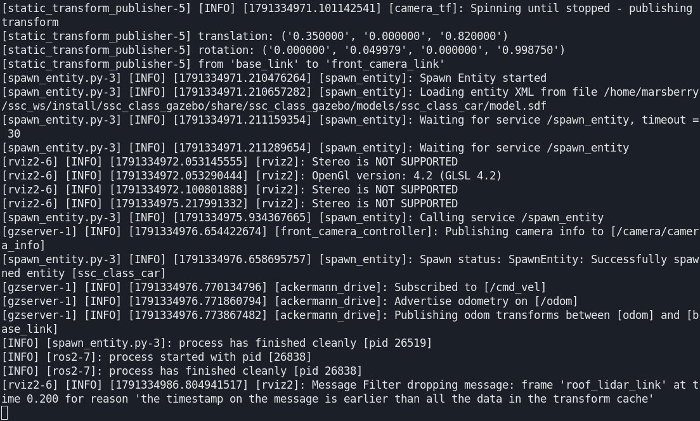

`Successfully spawned entity [ssc_class_car]` 와 `[ackermann_drive] Subscribed to [/cmd_vel]` 이 보이면 정상입니다. 마지막의 `Message Filter dropping message` 1~2줄은 무시해도 됩니다.

터미널 2 — 내 작업 공간:

```bash
source ~/basics_ws/install/setup.bash
```

## 1. rviz2 — 스캔을 눈으로

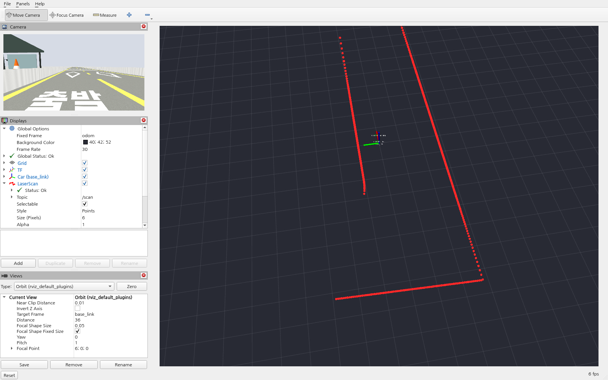

- 빨간 점 = `/scan` (720점), RGB 축 = 차량(`base_link`), 격자 1칸 = 2 m, 왼쪽 위 = `/camera/image_raw`
- **Displays** 패널에서 체크로 켜고 끕니다. **Global Options → Fixed Frame** 은 `odom`.
- 디스플레이를 직접 추가하려면 **Add → By display type → LaserScan**, Topic 을 `/scan` 으로 (Reliability: Best Effort).

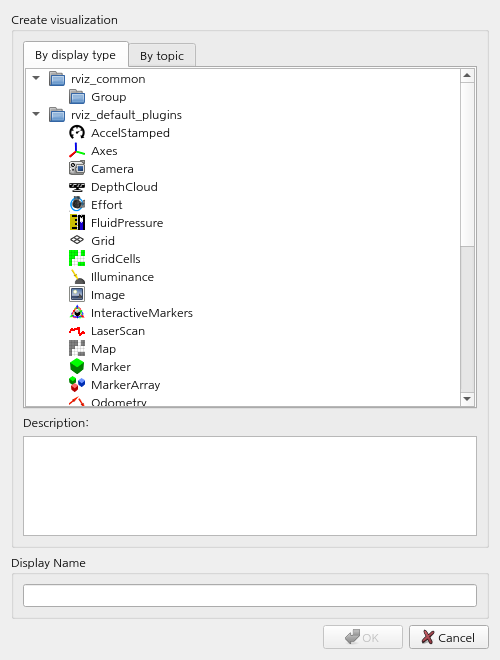

> WSLg(Mesa) 환경에서는 **Odometry** 디스플레이가 3D 화면을 올리브색으로 덮는 렌더링 문제가 있어 기본 꺼 두었습니다. 네이티브 Ubuntu 라면 켜도 됩니다.

### 1-1. 장애물 놓기 — GUI

1. Gazebo 상단 툴바의 **상자(Box) 아이콘** 클릭 → 마우스를 따라오는 회색 박스를 차 앞 도로 위에서 한 번 더 클릭해 내려놓습니다.
2. **이동 툴(✥)** 선택 후 박스 클릭 → 빨강(x)·초록(y) 화살표를 끌어 차 정면으로 옮깁니다. 왼쪽 World 탭에 `unit_box` 가 생깁니다.
3. 지우기: 박스 클릭 → `Delete` 키 (또는 Ctrl+Z).

<p>
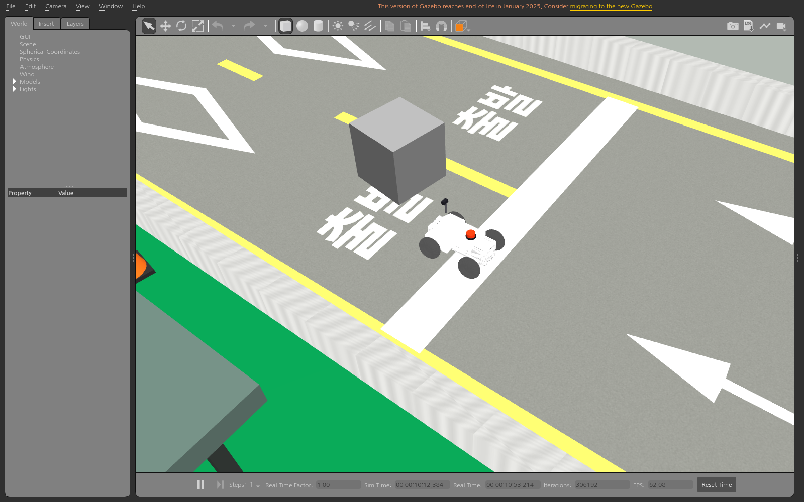
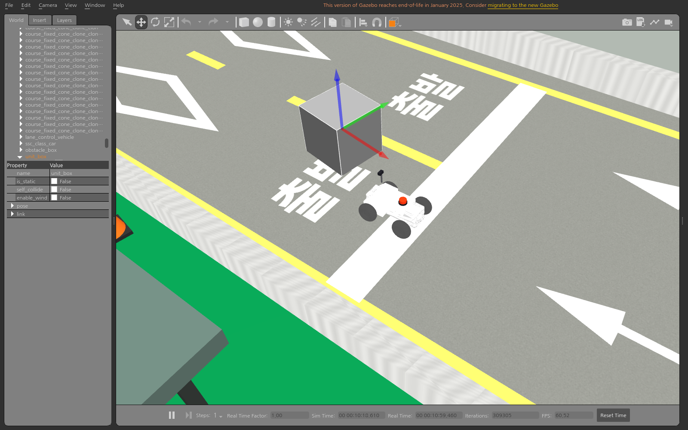
</p>

### 1-2. 장애물 놓기 — 명령어 (비교 실험은 이 방법으로)

차는 출발선에서 **-x 방향**을 보고 섭니다. 차 정면 d m 지점:

| 거리 | x | y |
|---|---|---|
| 5 m | 5.61 | 46.83 |
| 10 m | 0.68 | 46.00 |
| **15 m (기본)** | **-4.25** | **45.17** |
| 20 m | -9.18 | 44.33 |

```bash
ros2 run gazebo_ros spawn_entity.py -entity obstacle_box \
  -file ~/ssc_ws/src/ssc_class/weeks/week-06/box.sdf -x -4.25 -y 45.17 -z 0.5
```

제거는 Gazebo 에서 박스 클릭 → `Delete` 키.

<p>
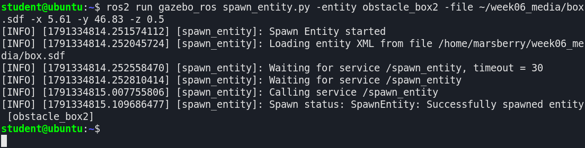
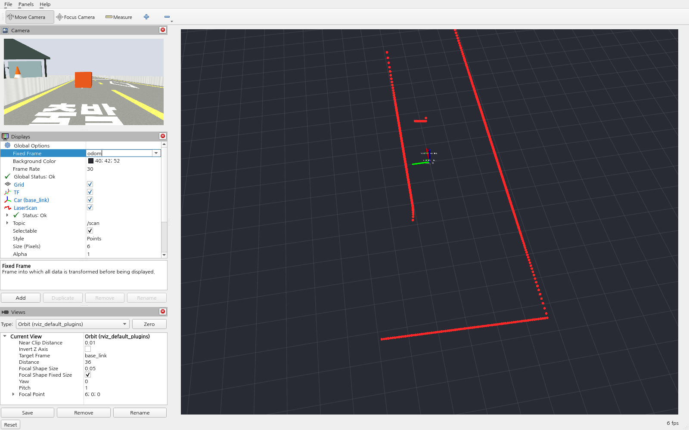
</p>

### 1-3. /scan 을 숫자로

```bash
ros2 topic info /scan                       # 타입·발행자/구독자 수
ros2 topic hz /scan                         # 20 Hz
ros2 topic echo /scan --once | head -34     # 메타데이터 + ranges 앞부분
ros2 topic echo /scan --once --field ranges # 720개 값만
```

<p>
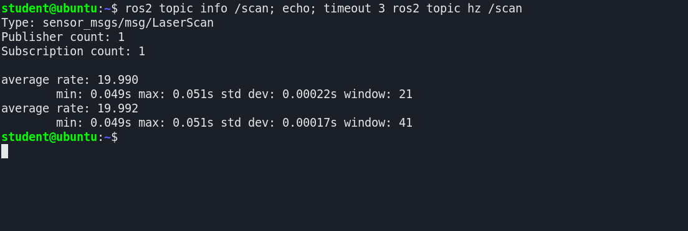
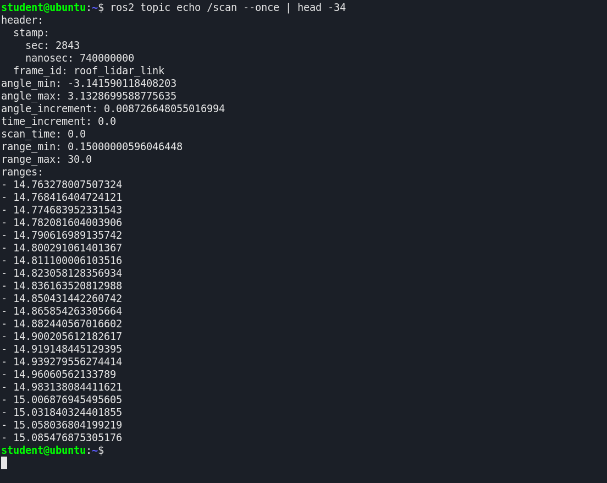
</p>

`angle_min = -π`, `angle_increment = 0.0087 rad(0.5°)`, `range 0.15~30 m`. 정면은 인덱스 360, 왼쪽(+90°)은 540.

코드로 읽어 보기 — `ranges` 는 720개짜리 리스트라 `msg.ranges[i]` 로 i 번째 광선의 거리를 꺼내면 됩니다. 어느 방향인지는 `각도 = angle_min + i × angle_increment` 로 확인합니다 (i=360 → 0도 = 정면):

```python
print('정면   i=360 :', round(msg.ranges[360], 2), 'm')
print('왼쪽   i=540 :', round(msg.ranges[540], 2), 'm')
angle = msg.angle_min + 360 * msg.angle_increment
print('i=360 의 각도  :', round(math.degrees(angle), 1), '도')
```


```bash
cd ~/ssc_ws/src/ssc_class && python3 weeks/week-06/scan_dump.py
```

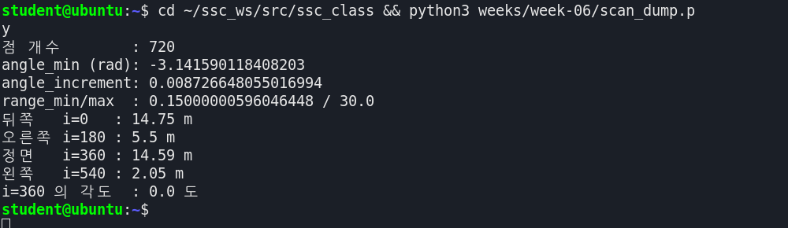

### 1-4. Gazebo 안에서 광선 보기

```bash
ros2 launch ssc_class_gazebo license_course.launch.py lidar_viz:=true     # 터미널 1 (기존 런치 대신)
```

Gazebo ray 센서는 SDF 의 `<visualize>true</visualize>` 이면 광선을 그려 줍니다. 평소엔 렌더링 부하를 줄이려고 꺼 두고, 이 인자는 `model.sdf` 의 LiDAR 부분만 켠 **사본**을 스폰합니다(원본은 그대로). 파란 선이 끝나는 곳이 `ranges[i]` — 연석·박스에 닿는 광선은 짧고, 30 m 를 넘는 방향은 `inf` 입니다.

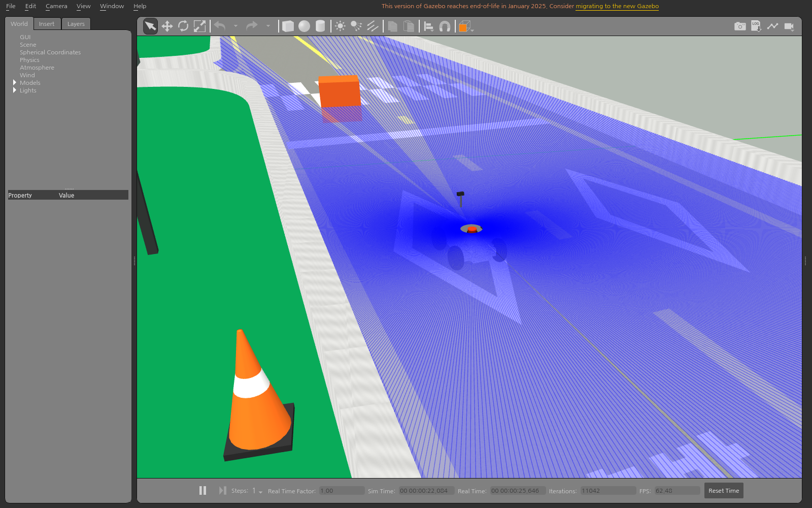

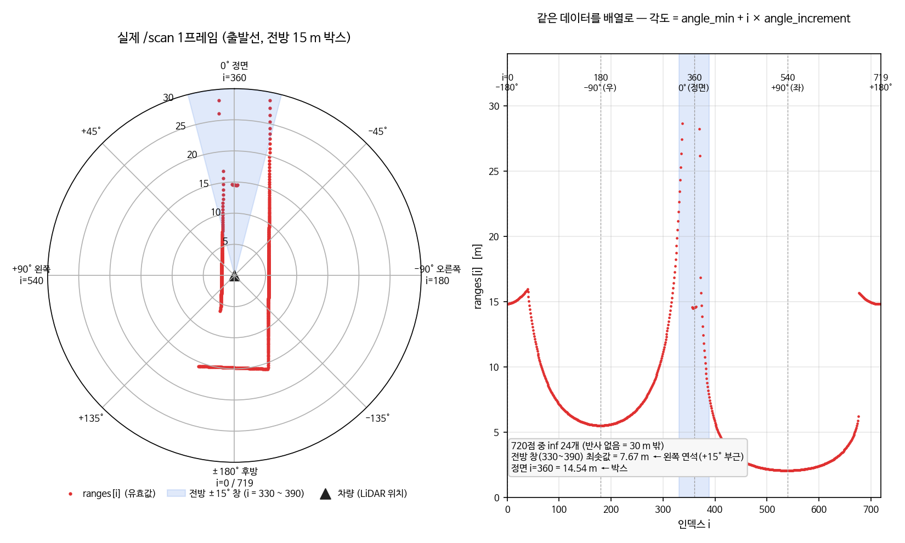

> 출발선에서는 전방 ±15° 창(i=330~390) 안에 **왼쪽 연석(+15° 부근, 약 7.7 m)** 이 들어옵니다. 박스가 15 m 에 있어도 `front` 는 7.7 m 로 찍히다가, 박스가 그보다 가까워지면 박스 거리로 바뀝니다.

## 2. scan_watcher — 전처리 장착

`~/basics_ws/src/basics/basics/scan_watcher.py` (세 노드의 전체 코드는 이 폴더의 `nodes/` 에 있습니다 — 복사해서 쓰세요):

```python
def on_scan(self, msg):
    c = len(msg.ranges) // 2                                  # 정면 인덱스 360
    w = int(math.radians(15.0) / msg.angle_increment)        # ±15° → 30개
    window = msg.ranges[c - w: c + w + 1]                     # ① 전방 창 (61개)
    valid = []                                                # ② 유효값 필터
    for r in window:
        if math.isfinite(r) and r > msg.range_min:            #    inf 아니고 너무 가깝지 않은 값만
            valid.append(r)
    if valid:
        self.front = min(valid)                               # ③ 최솟값 (과제 ②에서 강건화)
```

| 변수 | 뜻 | 우리 차량에서 |
|---|---|---|
| `c` | 정면 인덱스 = `len(ranges)//2` | 720//2 = **360** (0°) |
| `w` | ±15° 가 몇 칸인지 = `radians(15) / angle_increment` | 0.2618 / 0.00873 → **30칸** |
| `window` | 정면 양옆 w칸씩 = `ranges[330:391]` | **61개** |
| `valid` | window 에서 inf 와 range_min 미만을 뺀 값들 | 보통 40~60개 |
| `front` | valid 의 최솟값 = 가장 가까운 것 | 예: 4.44 m |

구독은 반드시 `qos_profile_sensor_data` 로. 세 파일을 복사해 넣고 `setup.py` 의 `console_scripts` 에 세 줄을 추가한 뒤 빌드:

```bash
cp ~/ssc_ws/src/ssc_class/weeks/week-06/nodes/*.py ~/basics_ws/src/basics/basics/
```

```python
# ~/basics_ws/src/basics/setup.py
entry_points={
    'console_scripts': [
        # ... 3주차에 만든 것들 ...
        'scan_watcher = basics.scan_watcher:main',
        'aeb_distance = basics.aeb_distance:main',
        'aeb_ttc = basics.aeb_ttc:main',
    ],
},
```

```bash
cd ~/basics_ws && colcon build --symlink-install && source install/setup.bash
ros2 run basics scan_watcher
```

> 빈칸 채우기로 직접 써 보고 싶으면 `skeleton/` 의 TODO 버전을 쓰세요.

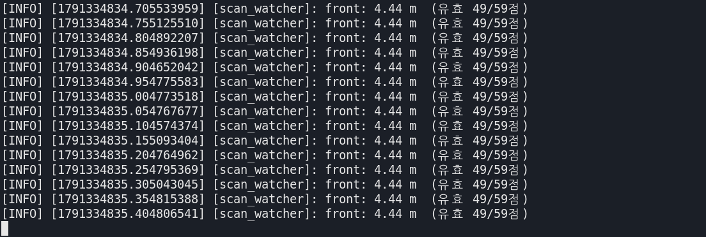

## 3. rosbag2 — 접근 주행을 기록한다

박스를 15 m 에 두고, 텔레옵(또는 아래 한 줄)으로 1 m/s 접근하며 기록. 충돌 직전 `k`(또는 Ctrl+C) 로 정지:

```bash
ros2 bag record /scan /odom -o approach1                                             # 터미널 A
ros2 topic pub --rate 10 /cmd_vel geometry_msgs/msg/Twist "{linear: {x: 1.0}}"     # 터미널 B (텔레옵 대신)
ros2 topic pub --once /cmd_vel geometry_msgs/msg/Twist "{}"                          # 정지
```

<p>
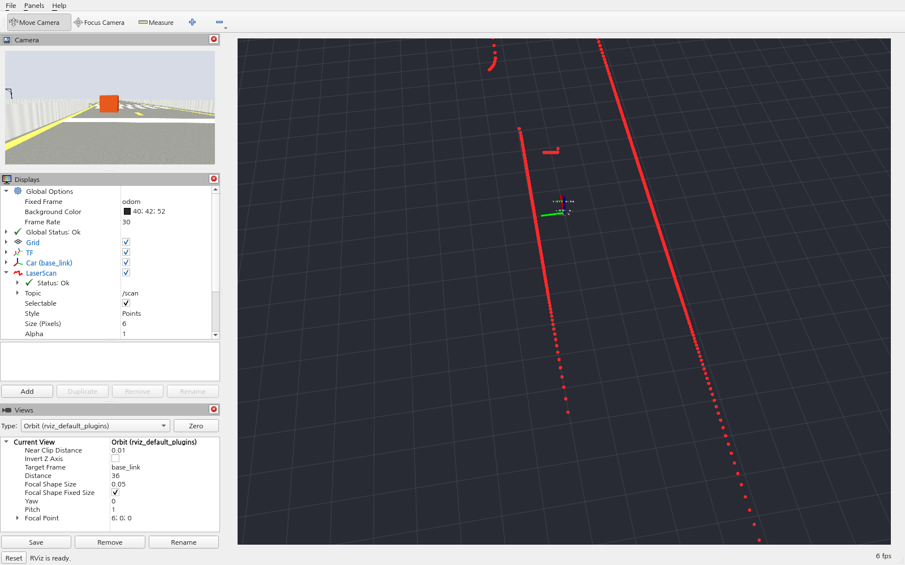
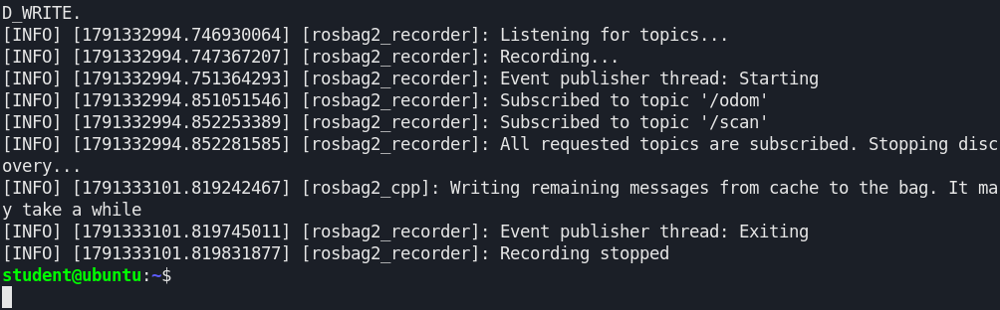
</p>

기록 확인 → **시뮬레이터를 끄고**(런치 Ctrl+C) 재생만으로 scan_watcher 테스트:

```bash
ros2 bag info approach1
ros2 bag play approach1          # 터미널 A
ros2 run basics scan_watcher     # 터미널 B — 그때 그대로 값이 줄어든다
```

<p>
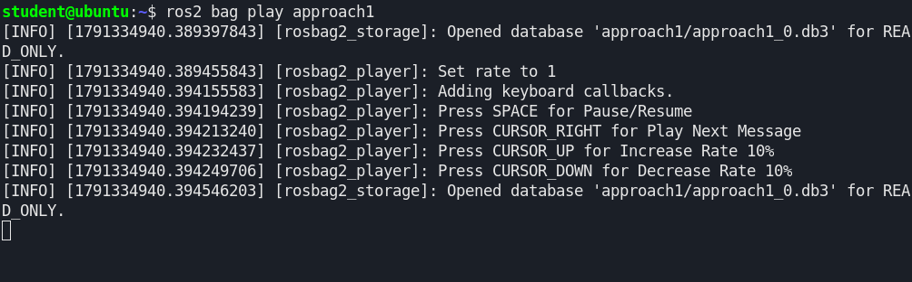
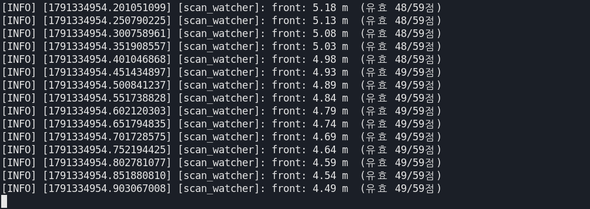
</p>

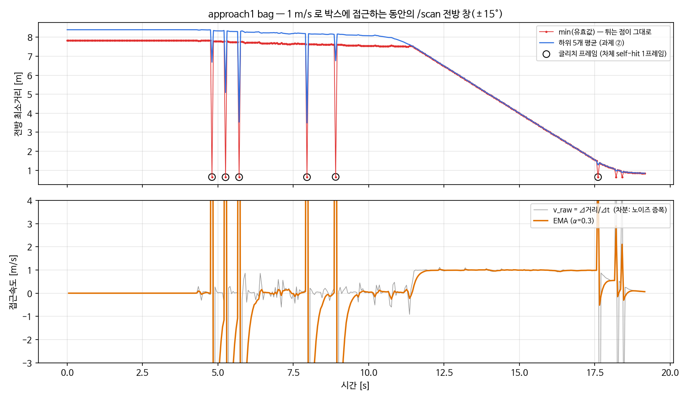

> 가속 중 LiDAR 가 자기 차체를 한 프레임씩 찍는 **self-hit 글리치(0.3~0.6 m)** 가 실제로 있습니다. `min()` 그대로 AEB 를 만들면 출발 직후 급정지 → AEB 코드는 "최근 2프레임의 max" 로 한 프레임 튐을 무시합니다(과제 ②는 하위 5개 평균).

## 4. AEB v1 — 거리 기반

```bash
ros2 run basics aeb_distance                        # 전방 < stop_dist(5 m) → 정지
ros2 param set /aeb_distance stop_dist 3.0          # 노드 재시작 없이
```

<p>
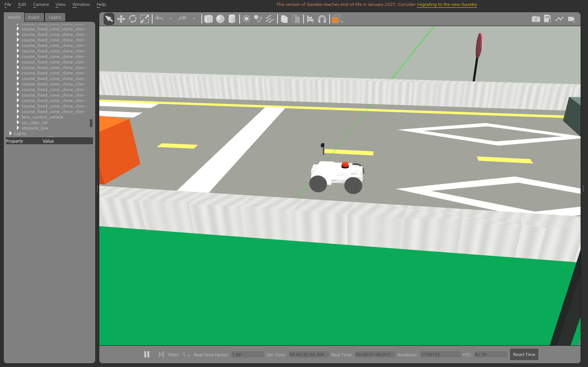
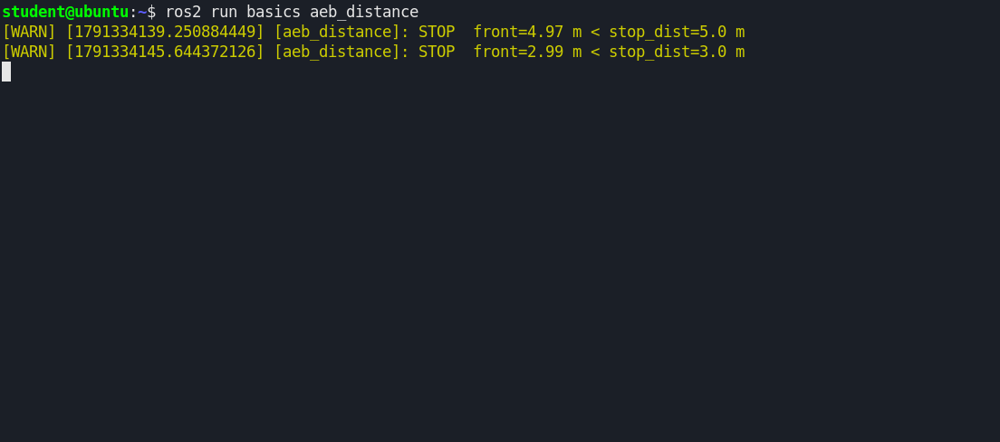
</p>

실측(1 m/s): `stop_dist 5.0` → STOP 명령 4.97 m, 최종 정지 **4.46 m** / `3.0` → 2.99 m → **2.80 m**.
한계 체험: `ros2 param set /aeb_distance speed 2.5` 로 빠르게 접근하면 제동거리가 늘어 아슬아슬, `0.2` 로 기면 5 m 나 남겨 두고 선다.

## 5. AEB v2 — TTC 기반 + 튜닝

```bash
ros2 run basics aeb_ttc                              # 터미널 2: TTC < ttc_threshold(2.0 s) → 정지
ros2 param set /aeb_ttc ttc_threshold 1.0            # 터미널 3: 늦게, 가까이
ros2 param set /aeb_ttc ttc_threshold 3.0            # 일찍, 멀리
ros2 param dump /aeb_ttc                             # 최종값 (제출용)
ros2 run basics aeb_ttc --ros-args -p ttc_threshold:=1.5   # 시작할 때 값을 주려면
```

파라미터는 노드 안에서 `declare_parameter('ttc_threshold', 2.0)` 로 선언하고, **tick 마다** `get_parameter(...).value` 로 읽어야 `param set` 이 즉시 반영됩니다.

<p>
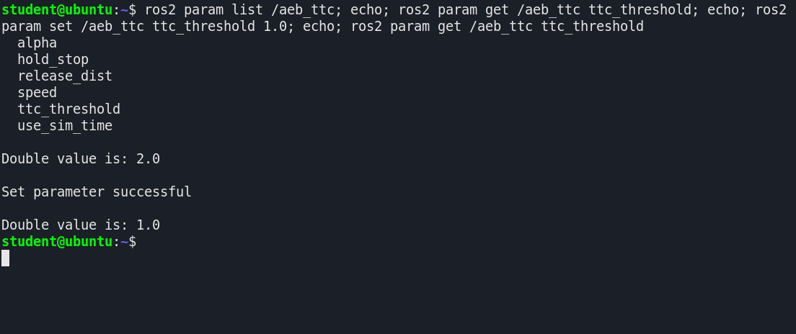
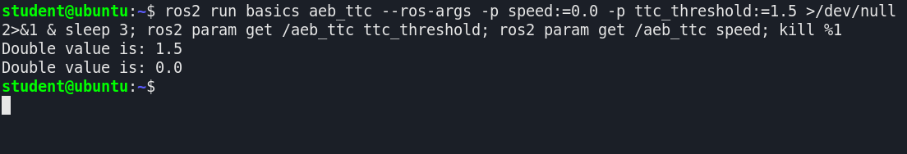
</p>

<p>
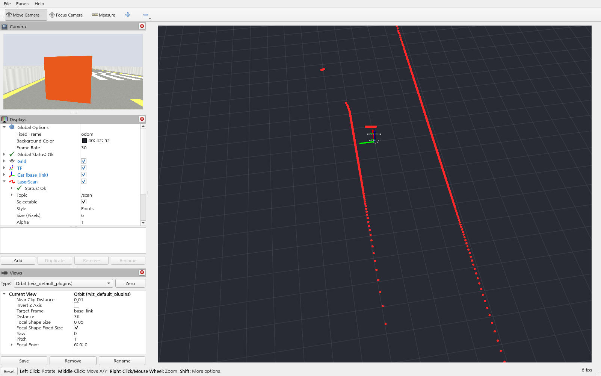
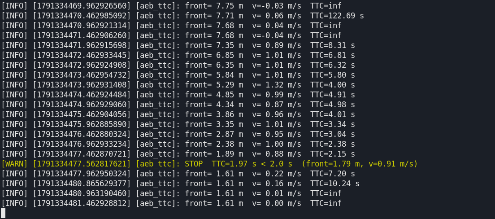
</p>

| 설정 | STOP 명령 시점 | 최종 정지 거리 |
|---|---|---|
| v1 stop_dist 5.0 | 4.97 m | 4.46 m |
| v1 stop_dist 3.0 | 2.99 m | 2.80 m |
| v2 TTC 1.0 s | 0.97 m | 0.73 m |
| v2 TTC 2.0 s | 1.79 m | 1.61 m |
| v2 TTC 3.0 s | 2.92 m | 2.22 m |

`aeb_ttc` 는 한 번 멈추면 **정지를 유지**합니다(`hold_stop`, 기본 true). 멈추면 접근속도 → 0, TTC → ∞ 가 되어 바로 재출발하는 **채터링**이 생기기 때문입니다. `ros2 param set /aeb_ttc hold_stop false` 로 끄면 아래처럼 STOP → 재출발 → STOP … 을 반복하며 박스까지 기어갑니다. 전방이 `release_dist`(6 m) 보다 멀어질 때(후진·박스 제거) 해제 — "3초 유지" 는 과제 ③.

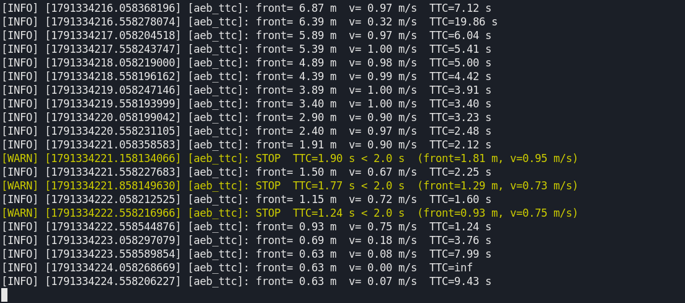

### 5-1. 이론 17~21p 를 한 파일로 — `aeb_ttc_simple.py`

이론 슬라이드의 코드 조각(전처리 → 접근속도·EMA → TTC → 판단·제어)이 한 노드 안에서 어떻게 연결되는지 보여 주는 최소 버전입니다 (파라미터·정지 해제 없음):

```bash
cd ~/ssc_ws/src/ssc_class && python3 weeks/week-06/aeb_ttc_simple.py
```

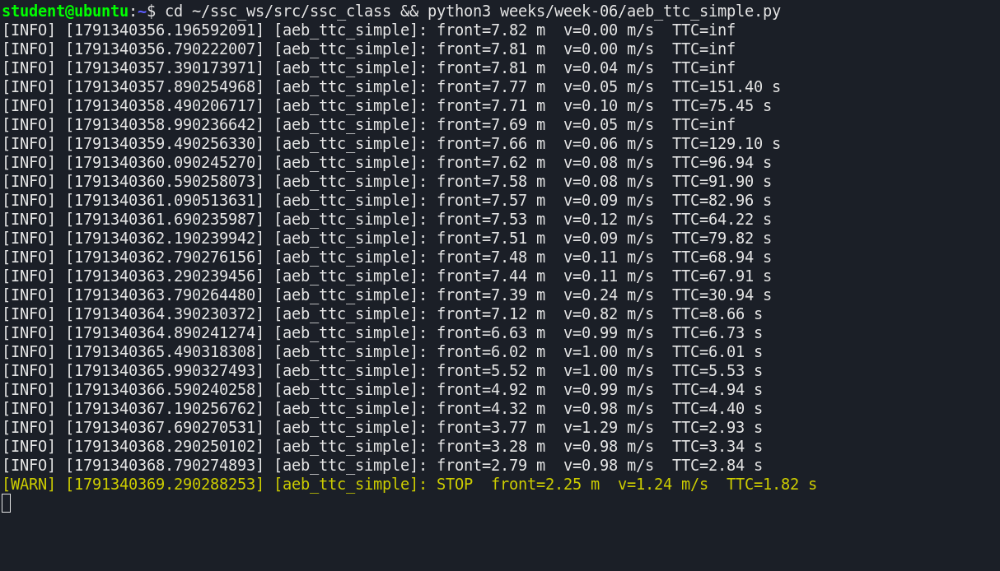

`/scan`(20 Hz) → `on_scan`: 전처리 → d → v(EMA) ⇒ `tick`(10 Hz): `ttc() < 2.0` ? 정지 : 순항 → `/cmd_vel`. 실측: TTC 1.82 s 에서 STOP, front 2.25 m.

## 6. 되돌아가서 다시 — 반복 시험 루프

시험 한 번 끝날 때마다 차를 뒤로 물립니다 (서비스 대신 **토픽**으로):

```bash
# 텔레옵 , (후진) 로 박스에서 8 m 이상 물러난 뒤 k — 또는
ros2 topic pub --rate 10 --times 80 /cmd_vel geometry_msgs/msg/Twist "{linear: {x: -1.0}}"
ros2 topic pub --once /cmd_vel geometry_msgs/msg/Twist "{}"      # 미끄러지면 정지 1회
```

전방이 6 m 를 넘으면 `aeb_ttc` 의 정지가 풀려 다시 접근합니다. 루프: 물러나기 → 파라미터 설정 → 접근 → 정지 거리 기록 → … 처음부터 다시 하려면 런치 터미널 Ctrl+C 후 재실행.

## 자주 발생하는 문제

| 증상 | 해결 |
|---|---|
| `/scan` 콜백이 안 불림 | `qos_profile_sensor_data` 확인 (이 시뮬레이터는 RELIABLE 로 발행해 기본 QoS 로도 받히지만, 실차 센서는 대부분 BEST_EFFORT) |
| 출발 직후 front 0.3~0.6 m 로 급정지 | self-hit 글리치 — 2프레임 연속 조건(aeb 코드의 `recent`) 또는 과제 ② |
| bag 재생 값이 섞임 | 시뮬레이터가 켜져 있음 → `ros2 topic info /scan` 의 Publisher count 가 1 이어야 |
| `Could not find metadata in bag directory` | 기록을 Ctrl+C 로 정상 종료하지 않음 → 다시 기록 |
| rviz2 3D 화면이 올리브색으로 덮임 (WSLg) | Odometry 디스플레이 체크 해제 |
| 후진으로 물러난 뒤 차가 미끄러짐 | 정지 명령 1회 발행 |


## 부록. `qos_profile_sensor_data` 가 뭔가

ROS 2 가 **미리 정의해 둔** QoS 프로파일입니다(`rmw_qos_profile_sensor_data`). 직접 만들지 않고 `from rclpy.qos import qos_profile_sensor_data` 로 가져다 씁니다.

| 정책 | `qos_profile_sensor_data` | 기본값 `create_subscription(…, 10)` |
|---|---|---|
| Reliability | **BEST_EFFORT** — 못 받은 건 포기 | RELIABLE — 재전송해서라도 전달 |
| History / Depth | KEEP_LAST **5** | KEEP_LAST 10 |
| Durability | VOLATILE | VOLATILE |

호환 규칙: 구독자가 발행자보다 "덜 까다로워야" 연결됩니다. BEST_EFFORT 구독은 RELIABLE·BEST_EFFORT 어느 발행자와도 맞지만, RELIABLE 구독은 BEST_EFFORT 발행자(실차 LiDAR 드라이버 대부분)와 **연결되지 않고 콜백이 조용히 안 불립니다**. 이 시뮬레이터는 RELIABLE 로 발행하므로 숫자 10 으로도 동작하지만, 센서 구독은 습관처럼 `qos_profile_sensor_data` 를 씁니다.

```bash
python3 -c "from rclpy.qos import qos_profile_sensor_data as q; print(q.reliability, q.history, q.depth, q.durability)"
ros2 topic info -v /scan        # 발행자·구독자의 QoS 를 나란히 확인
```

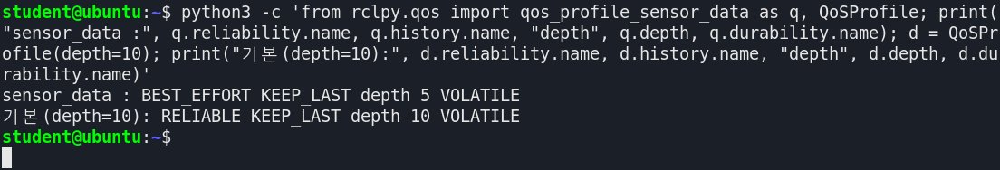

같은 것을 직접 만들면: `QoSProfile(depth=5, reliability=ReliabilityPolicy.BEST_EFFORT)`.

## 과제 (LMS, 다음 수업 전날 23:59)

1. 비교 리포트 — 접근 속도 2가지 × {v1, v2} 의 정지 거리 표 + 한 줄 해석 (위 표 형식)
2. 강건한 전처리 — `min()` 대신 유효값 하위 5개 평균 (`img/19_bag_front_velocity.png` 의 파란 선)
3. (도전) 히스테리시스 — 정지 진입(TTC<2 s)과 재출발(전방 > 6 m 가 3초 유지) 분리
- 공통 제출물: `ros2 param dump /aeb_ttc` 결과
