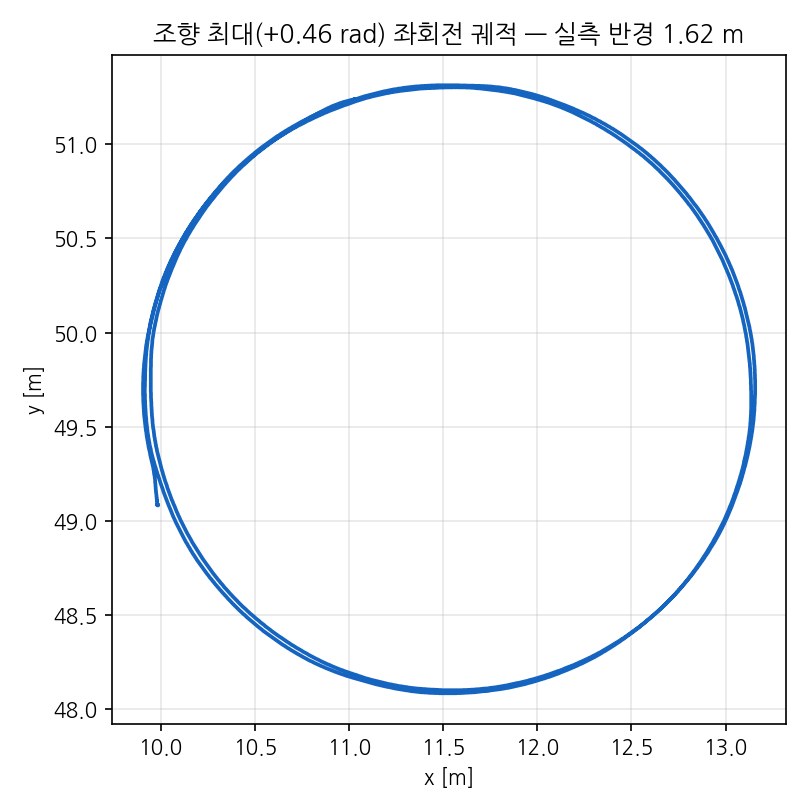
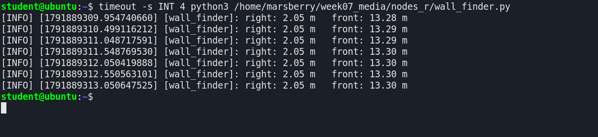
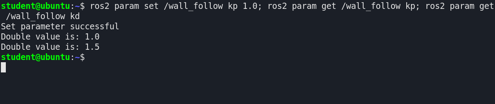
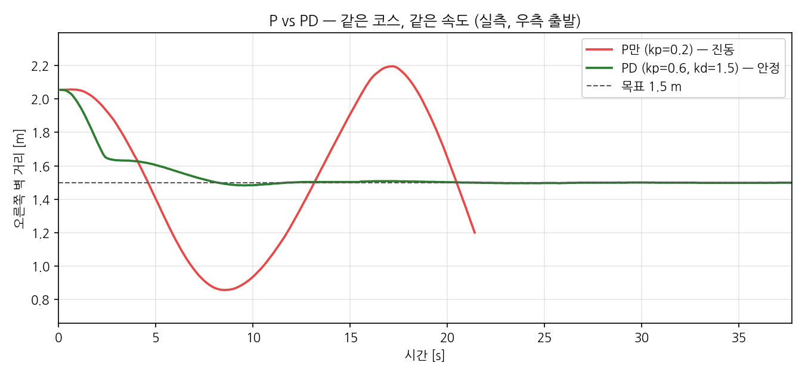

# 7주차 — 판단 1: Wall Following과 PD 제어

> 멈추는 차(6주차 AEB)에서 **달리는 차**로. **오른쪽 연석**과 일정 거리를 유지하며 직선 구간을 자율 주행합니다.
> 본 주차 신규 개념은 셋: **회전 기하 · P · D**. 코드는 6주차 `aeb_distance` 의 뼈대가 이미 들어 있는 **빈칸 파일**에서 시작해, 단계마다 `★ TODO` 를 하나씩 채웁니다.
> 명령어는 이 문서에서 **복사–붙여넣기** 하세요. `wall_finder.py` 는 완성본, `wall_follow.py` 는 빈칸 버전입니다 ([nodes/](nodes/)).

## 실습 로드맵 — 총 6단계

0. 주차 루틴 — week-07 수령 + 시뮬레이터 (**start:=right**) + 파일 구조 확인
1. 회전반경 실측 — 이론값 1.31 m의 검증 (⚠ 좌회전으로) + **차량 리셋 방법**
2. `wall_finder` — 텔레옵으로 차를 움직이며 오른쪽 거리 확인 (제어 없음)
3. `wall_follow` P — TODO ①②③ 구현 → 주행 → 진동 관찰
4. `wall_follow` D — TODO ④ 구현 → 게인 튜닝 → 목표선 안착
5. 챌린지 — TODO ⑤ 전방 정지(6주차 AEB 이식) 구현 → 박스 앞 자동 정지까지 완주

> ⚠ **단계 3·4 의 wall_follow 에는 브레이크가 없습니다** (전방 정지는 단계 5에서 직접 넣습니다).
> 연석에 가까워지면 **Ctrl+C → 차량 리셋**(단계 1-2) 을 습관처럼.

---

## [단계 0] 주차 루틴

### 0-1. 시뮬레이터 — 이번 주부터 출발 위치는 도로 우측

터미널 1:

```bash
cd ~/ssc_ws/src/ssc_class
git pull
git remote update
git checkout week-07
cd ~/ssc_ws && colcon build --symlink-install     # launch 파일이 갱신되므로 재빌드 1회
source ~/ssc_ws/install/setup.bash
ros2 launch ssc_class_gazebo license_course.launch.py start:=right
```

`start:=right` 를 빼면 2~6주차의 좌측 출발점에 스폰됩니다 — 이번 주 모든 실습은 **우측 출발** 기준입니다.

터미널 2 (내 작업 공간):

```bash
source ~/basics_ws/install/setup.bash
```

> 환경 이상 시 [3주차 복구 절차](../week-03/README.md#단계-0-b-안-될-때--증상별-복구-절차) 선행.

### 0-2. 파일 구조 — 오늘 어디에 무엇을 만드는가

모든 코드는 3주차에 만든 `basics` 패키지에 **파일 2개를 추가**하는 것이 전부입니다. 다른 폴더는 건드리지 않습니다.

```
~/basics_ws/                      ← 내 워크스페이스 (시뮬레이터는 ~/ssc_ws, 분리)
└── src/basics/
    ├── package.xml
    ├── setup.py                  ← ③ 노드 등록 (entry_points 에 두 줄 추가)
    └── basics/
        ├── __init__.py
        ├── counter_pub.py, counter_sub.py, straight_stop.py   (3주차)
        ├── scan_watcher.py, aeb_distance.py, aeb_ttc.py        (6주차)
        ├── wall_finder.py        ← ① 오늘 추가 (완성본): 오른쪽 벽 거리 '보기'     [단계 2]
        └── wall_follow.py        ← ② 오늘 추가 (빈칸 버전): 벽 추종 주행          [단계 3~5]
```

두 파일 복사 → setup.py 등록 → 빌드 (한 번만 해 두면 이후 단계는 **파일 수정 → 빌드 → 실행**만 반복):

```bash
cp ~/ssc_ws/src/ssc_class/weeks/week-07/nodes/*.py ~/basics_ws/src/basics/basics/
```

```python
# ~/basics_ws/src/basics/setup.py  — entry_points 에 두 줄 추가
entry_points={
    'console_scripts': [
        # ... 3주차·6주차에 등록한 것들 ...
        'wall_finder = basics.wall_finder:main',
        'wall_follow = basics.wall_follow:main',
    ],
},
```

```bash
cd ~/basics_ws && colcon build --symlink-install && source install/setup.bash
```

> `--symlink-install` 로 빌드했으므로, 이후 `.py` 를 고쳤을 때는 **노드만 다시 실행**하면 반영됩니다 (setup.py 를 바꿨을 때만 재빌드).

## [단계 1] 회전반경 실측 — ⚠ 좌회전으로 수행

### 1-1. 원 주행

최대 조향(0.46 rad) 고정, 1 m/s 주행 시 차량 궤적은 원. 이론값 R = L/tan δ = 0.65/tan 26.4° ≈ **1.31 m**의 검증 (터미널 3):

```bash
ros2 topic pub --rate 10 /cmd_vel geometry_msgs/msg/Twist "{linear: {x: 1.0}, angular: {z: 0.46}}"
```

> ⚠ **오른쪽(−0.46) 회전은 오른쪽 연석(2.05 m)과 충돌** — 회전원 지름 ≈ 3 m > 우측 여유.
> 왼쪽(+0.46)은 5.5 m 여유가 있어 안전합니다.

충분히 회전 후 Ctrl+C, 정지:

```bash
ros2 topic pub --once /cmd_vel geometry_msgs/msg/Twist "{}"
```

**실측 결과** (제작 시 odom 궤적을 기록해 원 피팅한 결과 — 결과 제시용):



- 이론 1.31 m vs **실측 1.62 m** (좌회전, 원 피팅 잔차 1 cm) — 실효 조향각 ≈ 22° (명령 26.4°)
- 원인: 조향 서보의 목표각 미달 + 바퀴 미끄러짐 — **공식은 하한선**

### 1-2. 차량 리셋 — 출발선으로 되돌리기 (이후 모든 단계에서 사용)

원을 돌고 나면 차가 출발선을 벗어나 있습니다. 시뮬레이터를 끄지 않고 출발선(`start:=right` 위치)으로 되돌리는 방법:

```bash
ros2 service call /reset_world std_srvs/srv/Empty
```

차가 즉시 출발 위치·방향으로 돌아옵니다 (실측: 원 주행으로 3 m 벗어난 차가 출발점 10 cm 이내로 복귀, 리셋 후 재주행 정상).

- 리셋 전에 **차에 명령을 보내던 노드·명령은 먼저 Ctrl+C** — 리셋 직후 다시 달려 나가지 않도록
- 연석에 부딪혀 걸렸을 때, 실험을 처음부터 다시 할 때 모두 이 한 줄

## [단계 2] wall_finder — 제어 전 측정 확인

### 2-1. 코드

6주차 `scan_watcher` 의 "전방 ±15° 창" 을 "오른쪽 −90° ±4° 창" 으로 옮긴 것이 전부입니다. `basics/basics/wall_finder.py` (단계 0에서 복사한 완성본):

```python
def sector_min(msg, center_deg, half_deg):
    """center_deg 방향 ±half_deg 창에서 유효한 거리값의 최솟값. 유효값이 없으면 -1.0"""
    center = len(msg.ranges) // 2 + int(math.radians(center_deg) / msg.angle_increment)
    half = int(math.radians(half_deg) / msg.angle_increment)
    best = -1.0                                   # -1.0 = 아직 유효값 없음
    for i in range(center - half, center + half + 1):
        r = msg.ranges[i]
        if not math.isfinite(r):                  # inf / NaN 은 버린다
            continue
        if r <= msg.range_min:                    # 센서 자체 노이즈(너무 가까운 값)도 버린다
            continue
        if best < 0.0 or r < best:
            best = r
    return best

class WallFinder(Node):
    ...
    def on_scan(self, msg):
        right = sector_min(msg, -90.0, 4.0)       # 오른쪽 연석: 정면(360) − 180 = 인덱스 180 주변
        front = sector_min(msg, 0.0, 10.0)        # 전방
        self.get_logger().info('right: %.2f m   front: %.2f m' % (right, front),
                               throttle_duration_sec=0.5)
```

- 인덱스: 정면 = 360, 오른쪽 −90° = 360 − 90°/0.5° = **180** (왼쪽 +90° = 540)
- `sector_min` 은 6주차 전처리(유효값 필터 + 최솟값)를 함수로 뺀 것 — `wall_follow.py` 에도 같은 함수가 들어 있습니다

### 2-2. 실행하고, 차를 직접 움직여 확인

터미널 2:

```bash
ros2 run basics wall_finder
```



출발선에서 `right ≈ 2.05 m` 이면 정상. 이제 **차를 직접 움직여** 값이 따라 변하는지 봅니다. 터미널 3 (2주차의 키보드 조종):

```bash
ros2 run teleop_twist_keyboard teleop_twist_keyboard
```

| 키 | 동작 |
|---|---|
| `i` / `,` | 전진 / 후진 |
| `u` / `o` | 전진하며 좌 / 우 조향 (후진은 `.` / `m`) |
| `k` | **정지** — 키를 떼도 마지막 명령이 유지되므로 반드시 `k` |
| `z` | 속도 10% 감소 (처음엔 `z` 를 여러 번 눌러 천천히) |

확인할 것:

1. `o` 로 오른쪽으로 비스듬히 전진 → `right` 가 **줄어드는가** (연석에 1 m 이내로 붙기 전에 `k`)
2. `u` 로 왼쪽으로 비스듬히 전진 → `right` 가 **늘어나는가**
3. 확인이 끝나면 텔레옵 `k` → Ctrl+C → **차량 리셋** (단계 1-2)

> 텔레옵은 단계 3부터 쓰지 않습니다 — /cmd_vel 발행자가 둘이면 명령이 섞입니다. **반드시 Ctrl+C 로 종료.**

## [단계 3] wall_follow — P 구현

### 3-1. 빈칸 파일 읽기 — 6주차와 무엇이 같은가

`basics/basics/wall_follow.py` 를 엽니다. 6주차 `aeb_distance` 와 같은 뼈대(파라미터 → 콜백 → 10 Hz 타이머)는 완성되어 있고, `# ★ TODO` 자리만 비어 있습니다.

| 구간 | 6주차 aeb_distance | 이번 주 wall_follow (빈칸 파일) |
|---|---|---|
| 파라미터 | stop_dist, speed | speed, front_stop, **target_dist, kp, kd** — 선언 완료 |
| 상태 변수 | front, stopped | front…, **right, prev_e, de_f …** — 선언 완료 |
| 인지(on_scan) | 전방 창 → front | **TODO ①** 오른쪽 거리 · **TODO ⑤-a** 전방 거리 |
| 판단·제어(tick) | front < stop_dist → 정지 | **TODO ⑤-b** 전방 정지 · **② 오차 → ④ 변화율 → ③ 조향** |

이번 단계에서 채울 곳은 **①②③** 입니다:

```python
    def on_scan(self, msg):
        # ★ TODO ① [단계 3] 오른쪽 벽 거리
        #    오른쪽 −90° ±4° 창의 최솟값을 self.right 에, 유효(0 이상) 여부를 self.right_ok 에.
        #    힌트: 단계 2 wall_finder 의 sector_min() 한 줄 + 비교 한 줄
    ...
    def tick(self):
        ...
        # ★ TODO ② [단계 3] 오차 — 멀면 +, 가까우면 −
        e = 0.0
        ...
        # ★ TODO ③ [단계 3] 조향 = −(Kp·e + Kd·de)  (오른쪽 벽: 멀면 오른쪽(−) 으로)
        #    그리고 ±MAX_STEER 로 클램프 (if / elif)
        steer = 0.0
```

힌트 — 강의자료 이론부:

- ① 측면 거리 측정 (인덱스 180, `sector_min`)
- ② 오차 정의 `e = d − target` (오차의 부호 규약 장)
- ③ P 제어 코드박스 — 오른쪽 벽이므로 **부호 −**, 클램프는 `if / elif` 두 갈래. `de` 는 아직 0 이므로 Kd 항이 있어도 결과는 P 와 같습니다

### 3-2. 실행 — P 단독

파일 저장 후 (재빌드 불필요) 터미널 2:

```bash
ros2 run basics wall_follow --ros-args -p kp:=0.2 -p kd:=0.0
```

| 확인 | 정상 | 아니면 |
|---|---|---|
| 출발 직후 | 오른쪽(연석 쪽)으로 살짝 꺾으며 전진 | 왼쪽으로 꺾으면 **부호 오류** (③) / 안 움직이면 ① 의 `right_ok` |
| 1.5 m 근처 | 목표선을 **지나쳐 0.9 m 부근까지** 파고들었다가 되돌아감 | — 이것이 P 의 진동 (정상) |

> ⚠ 브레이크가 없습니다. 연석에 가까워지거나 직선 끝에 다다르면 **Ctrl+C → 차량 리셋**.

### 3-3. Kp 를 올려 보기

차량 리셋 후 다시 실행하며 Kp 만 바꿔 봅니다 (또는 실행 중 `ros2 param set /wall_follow kp 0.3`):

```bash
ros2 run basics wall_follow --ros-args -p kp:=0.3 -p kd:=0.0
ros2 run basics wall_follow --ros-args -p kp:=0.8 -p kd:=0.0
```

**실측** (우측 출발, target 1.5 m, 1.0 m/s):

| 설정 | 벽거리 거동 |
|---|---|
| kp 0.2 | **0.86 ↔ 2.19 m 진동** (sd 0.443 m) — 목표를 지나치고 되돌아오기를 반복 |
| kp 0.3 | 더 세게 꺾어 **연석 쪽으로 쏠림** — 연석에 닿기 전에 Ctrl+C |
| kp 0.8 | 초기 오차에 **조향 포화**(±0.40) → 급선회, 바로 연석으로 돌진 — 즉시 Ctrl+C |

▶ [P 진동 주행 영상](img/wall_follow_p_osc.mp4) — 제작 시 완성본(전방 정지 포함)으로 촬영

결론: **Kp 하나로는 진동을 잡을 수 없다** → 단계 4.

## [단계 4] wall_follow — D 구현

### 4-1. TODO ④

```python
        # ★ TODO ④ [단계 4] 오차 변화율 de (D 항)
        #    차분 (e − self.prev_e) / 0.1 → EMA 필터로 self.de_f 갱신 → de 에 대입
        #    첫 tick 은 비교 대상이 없으므로 self.have_prev 로 구분, 끝에서 prev_e·have_prev 갱신
        de = 0.0
```

힌트 — 강의자료 D 항 코드박스. 구조는 6주차 TTC 의 접근속도 계산(차분 → EMA)과 같습니다. 조향식(③)에는 이미 `kd * de` 가 들어 있으므로 ④ 만 채우면 됩니다.

### 4-2. 실행 — PD

차량 리셋 후:

```bash
ros2 run basics wall_follow --ros-args -p kp:=0.6 -p kd:=1.5
```

- 정상: 목표선(1.5 m)에 **한 번에 다가가 그대로 붙어** 달린다
- 실행 중 튜닝: `ros2 param set /wall_follow kd 1.0` 등 (6주차와 같은 방식)



**실측 비교** (동일 코스·동일 속도):

| 설정 | 흔들림(sd) | 평균 오차 |
|---|---|---|
| P 단독 (0.2, 0) | 0.443 m | 0.389 m |
| PD (0.3, 1.0) | 0.026 m | 0.015 m |
| **PD (0.6, 1.5) ★ 권장** (수렴이 더 빠름) | **0.029 m** | **0.016 m** |



> ⚠ 여전히 브레이크가 없습니다. 직선 끝에서 차는 연석을 따라 계속 돕니다 — Ctrl+C → 리셋.

최종 게인 기록 (과제 제출물):

```bash
ros2 param dump /wall_follow
```

## [단계 5] 챌린지 — 전방 정지 이식 + 완주

### 5-1. 왜 노드 안에 넣는가

6주차 `aeb_ttc` 를 옆에서 같이 켜면, `wall_follow`(10 Hz)와 `aeb_ttc`(10 Hz)가 **둘 다 /cmd_vel 을 발행**해 명령이 번갈아 섞입니다(주행·정지 반복). 원칙: **한 토픽의 명령권은 한 노드에.** 그래서 본인이 만든 AEB 의 판단 규칙을 `wall_follow` 안으로 옮깁니다.

### 5-2. TODO ⑤ — 6주차 AEB 이식 (두 군데)

```python
    def on_scan(self, msg):
        ...
        # ★ TODO ⑤-a [단계 5] 전방 거리 — 6주차 aeb_distance 의 on_scan 이식
        #    전방 0° ±10° 창의 최솟값 → self.front, self.front_ok
        #    (6주차 2프레임 필터: 직전 값 self.front_last 가 더 크면 그 값을 쓴다 — 1프레임 튀는 점 무시)

    def tick(self):
        ...
        # ★ TODO ⑤-b [단계 5] 전방 정지 — 6주차 aeb_distance 의 tick 규칙 이식
        #    전방 거리가 유효하고 front_stop 보다 가까우면: 정지 명령(msg 그대로) 발행 후 return
```

- 열어 볼 파일: `~/basics_ws/src/basics/basics/aeb_distance.py` (6주차 본인 코드)
- ⑤-b 는 tick 의 **맨 앞**(오른쪽 거리 확인보다 먼저) — 안전 규칙이 조향보다 우선
- 2프레임 필터를 빼면 출발 직후 LiDAR 가 자기 차체를 찍는 글리치(0.6 m 안팎)에 수 초간 멈출 수 있습니다 (6주차 self-hit)

### 5-3. 챌린지 — 박스 앞 자동 정지까지 완주

우측 출발에서는 직선 끝을 막는 연석이 없으므로(오른쪽 연석은 코너를 따라 이어짐), **출발선 22 m 앞 목표선 위에 박스**를 놓고 그 앞에서 멈추는 것을 완주로 봅니다. 6주차 박스 그대로 (터미널 3):

```bash
ros2 run gazebo_ros spawn_entity.py -entity obstacle_box \
  -file ~/ssc_ws/src/ssc_class/weeks/week-06/box.sdf -x -10.66 -y 48.26 -z 0.5
```

차량 리셋 후:

```bash
ros2 run basics wall_follow --ros-args -p kp:=0.6 -p kd:=1.5
```

**미션: 출발선 → 목표선을 따라 직선 주행 → 박스 앞에서 스스로 정지.** (실측: 출발 약 22초 후, 박스 약 2.1 m 앞에서 정지 — `front_stop` 2.5 m 에서 정지 명령, 관성으로 0.4 m 더 진행)

▶ [PD 완주 영상 — 박스 앞 자동 정지](img/wall_follow_pd.mp4)

판정: 연석 무접촉 + 박스 앞 자동 정지 + 벽거리 흔들림 최소. 여유 시 `ros2 param set /wall_follow speed 1.5` 로 동일 게인 검증 권장.

> 박스 제거: Gazebo 에서 박스 클릭 → `Delete` (또는 `ros2 service call /delete_entity gazebo_msgs/srv/DeleteEntity "{name: obstacle_box}"`). `/reset_world` 는 박스를 지우지 않고 제자리로 둡니다.

---

## 과제 (LMS, 다음 수업 전날 23:59)

| # | 내용 | 제출물 |
|---|---|---|
| 1 | **게인 리포트** — `log_csv` 파라미터로 P 단독/PD 두 주행 기록, 벽거리 최대·최소·표준편차 표 + 해석 1줄 | 표 + `param dump` |
| 2 (도전) | **왼쪽 벽 추종** — 바뀌는 곳은 두 군데(인덱스 540, 부호 +). 왜 그런지 설명 1줄 포함 (왼쪽 연석은 5.5 m — target 조정 필요) | 수정 .py + 주행 캡처 |
| 3 (도전) | **두 빔 보정** — 차체 기울어짐 시 측면 거리 과대측정. −90°·−60° 두 빔으로 벽 각도 α 산출·보정 (힌트: atan) | 작성 .py |

과제 1의 기록 방법 (TODO ①~⑤ 완성 후):

```bash
ros2 run basics wall_follow --ros-args -p kp:=0.2 -p kd:=0.0 -p log_csv:=/home/$USER/run_p.csv
ros2 run basics wall_follow --ros-args -p kp:=0.6 -p kd:=1.5 -p log_csv:=/home/$USER/run_pd.csv
```

## 자주 하는 실수

| 증상 | 해결 |
|---|---|
| 차가 전혀 안 움직임 | TODO ① 의 `self.right_ok` 가 계속 False — `sector_min` 결과가 0 이상인지 비교 |
| 벽으로 돌진 | 부호 오류 — e = d − target 인지, 조향 = **−**(Kp×e + …) 인지 확인 |
| kp 를 올리자 폭주 | 클램프(±0.40) 누락 — TODO ③ 의 if / elif |
| D 를 켰는데 변화 없음 | TODO ④ 에서 `de = self.de_f` 대입 누락, 또는 `prev_e`·`have_prev` 갱신 누락 |
| D항이 오히려 떨림 유발 | 차분 노이즈 — EMA α를 0.3 → 0.1로 |
| 출발 직후 몇 초 멈췄다 출발 | TODO ⑤-a 의 2프레임 필터 누락 (self-hit 글리치) |
| 박스 앞에서 안 멈춤 | TODO ⑤-b 가 tick 맨 앞에 있는지, `return` 했는지 |
| 회전반경 실험에서 연석 충돌 | **왼쪽(+0.46)** 으로 회전 (우측 출발 기준) |
| 차가 왼쪽 벽 쪽에서 출발함 | 단계 0의 `start:=right` 누락 (기본값은 좌측 스폰) |
| 리셋했더니 다시 달려 나감 | 노드·텔레옵을 Ctrl+C 로 먼저 끄고 리셋 |
| `ros2 run`에서 wall_follow 를 못 찾음 | setup.py 등록 + colcon build + 그 터미널에서 source |
